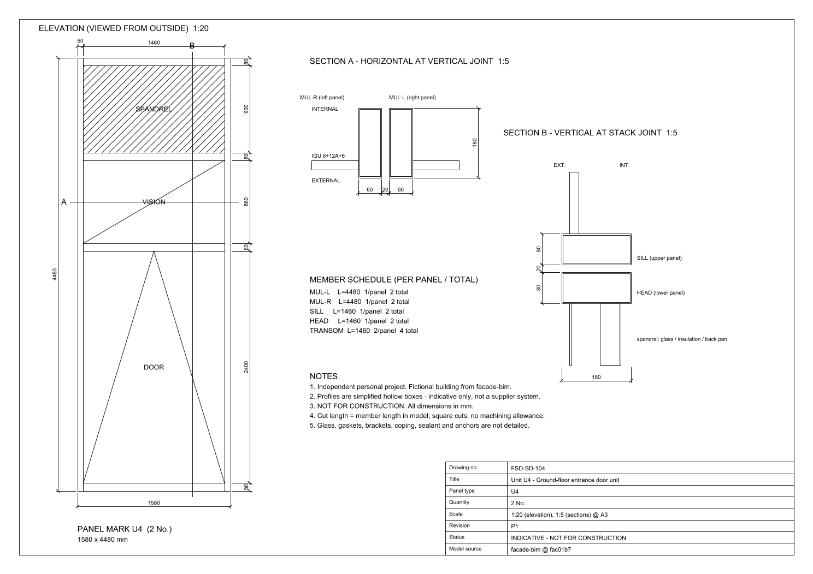
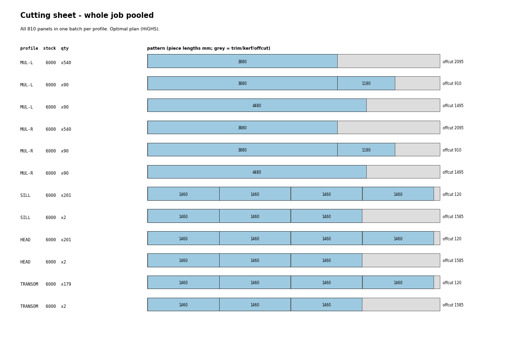

# facade-shop-drawings

[](https://github.com/LUOaini1213/facade-shop-drawings/actions/workflows/ci.yml)

Shop drawings, cutting lists and aluminium cutting-stock optimisation for the unitized
curtain wall of [facade-bim](https://github.com/LUOaini1213/facade-bim): 810 panels in 5 panel types
on a fictional 8-storey office block.

> **Scope.** This is an independent personal project, not professional or employer work.
> The building is fictional and comes from facade-bim. The frame profiles are simplified
> hollow boxes that carry only the module geometry (mullion width, transom height, frame
> depth, joint). They are **indicative, not a supplier's system, and not for construction.**



## What it produces

| Output | Files |
|---|---|
| 5 A3 shop drawings, one per panel type: elevation 1:20 with the full zone dimension chain, section A (horizontal, vertical joint) and section B (vertical, stack joint) at 1:5, member schedule, title block with drawing number, revision, scale and status | `out/drawings/FSD-SD-101.dxf` ... `FSD-SD-105.dxf`, `out/drawings/shop_drawings.pdf` |
| Drawing register | `out/drawing_register.csv` |
| Cutting list: 3,962 members, one row per member with mark, panel, profile and cut length | `out/members.csv` |
| Cutting plans: bar-by-bar, every cut tagged with its member mark; one per panel type plus a pooled whole-job plan | `out/cutting/plan_U1.csv` ... `plan_U5.csv`, `out/cutting/plan_pooled.csv`, `out/cutting/cutting_sheets.pdf` |
| FFD vs optimal comparison for every batch and profile; stock-length sensitivity | `out/cutting/summary.csv`, `out/cutting/stock_sensitivity.csv` |

The shop-drawing PDF is rendered from the DXF files, so the PDF and the CAD files cannot disagree.

## Input

Three files from facade-bim commit `fac01b7` are copied byte-for-byte into `upstream/` and pinned
by SHA-256 in `upstream/SOURCE.json`: `data/panels.csv` (every panel with size, per-panel infill
areas and frame mass), `data/takeoff.csv` and `facade/config.py` (read with `ast`, never executed).
Nothing in facade-bim is modified.

| Type | Name | Panels | Size W x H (mm) | Members per panel | Drawing |
|---|---|---|---|---|---|
| U1 | Ground-floor standard unit | 88 | 1,580 x 4,480 | 5 | FSD-SD-101 |
| U2 | Typical-floor unit | 620 | 1,580 x 3,880 | 5 | FSD-SD-102 |
| U3 | Plant-room louvre unit | 10 | 1,580 x 3,880 | 5 | FSD-SD-103 |
| U4 | Ground-floor entrance door unit | 2 | 1,580 x 4,480 | 6 | FSD-SD-104 |
| U5 | Parapet unit | 90 | 1,580 x 1,180 | 4 | FSD-SD-105 |

Each panel has two full-height mullions and horizontal members between them, as in facade-bim.
This repo splits them into five profiles, an assumption typical of unitized systems:
`MUL-L` / `MUL-R` (the two halves of a split mullion), `SILL` (lowest member), `HEAD`
(highest member) and `TRANSOM` (any intermediate member). Cut length is the member length in the
model: square cuts, no machining allowance.

## Cutting-stock method

Assumptions: stock bars of 6,000 and 6,500 mm; a 5 mm saw kerf per piece; 20 mm end trim per
bar to square the mill ends. A bar is feasible when the pieces plus one kerf each fit in the bar
minus the trim. Bars are profile-specific. Both methods are scored on the same objective:
minimise purchased bar length, then the number of bars.

- **FFD** (first-fit decreasing): pieces longest first, each into the first open bar it fits;
  new bars open at the longest stock length and are then shrunk to the shortest stock length
  that still holds them.
- **Optimal**: every feasible cutting pattern is enumerated (each profile has at most three
  distinct lengths, so the list is short) and an integer program picks pattern counts that cut
  the demand exactly. Solved with HiGHS (`highspy`), relative MIP gap set to zero.

## Results

Whole job, pooled per profile:

| Profile | Pieces | Bars | Purchased (m) | Yield | FFD vs optimum |
|---|---|---|---|---|---|
| MUL-L | 810 | 720 | 4,320.00 | 68.38% | +0.00% |
| MUL-R | 810 | 720 | 4,320.00 | 68.38% | +0.00% |
| SILL | 810 | 203 | 1,218.00 | 97.09% | +0.00% |
| HEAD | 810 | 203 | 1,218.00 | 97.09% | +0.00% |
| TRANSOM | 722 | 181 | 1,086.00 | 97.06% | +0.00% |
| **Total** | **3,962** | **2,027** | **12,162.00** | **76.69%** | **+0.00%** |

- The optimal plan is 2,027 bars of 6,000 mm: 12,162.00 m purchased for 9,326.92 m of members,
  yield 76.69%. The rest is offcut 2,774.73 m, kerf 19.81 m and end trim 40.54 m.
  The optimum uses 0 of 6,500 mm: the longer bar never pays on this job.
- **FFD already reaches the optimum** on all 29 instances (29 of 29: five pooled profiles and
  24 profile batches by panel type). Here the integer program does not save material; it proves
  that no plan with these bars does better.
- The waste comes from the member lengths, not the algorithm. A typical 3,880 mm mullion leaves a
  2,095 mm offcut in a 6,000 mm bar, so mullions yield 68.38% while sills, heads and transoms
  (1,460 mm, four to a bar) reach 97.06-97.09%.
- Cutting each panel type as its own batch needs 2,065 bars (12,390.00 m). Pooling the whole job
  lets the 1,180 mm parapet mullions share bars with storey-height mullions and saves 38 bars (228.00 m).



### Stock-length sensitivity (whole job, pooled)

| Stock lengths (mm) | Optimal bars | Optimal purchase (m) | Optimal yield | FFD bars | FFD purchase (m) | FFD vs optimum |
|---|---|---|---|---|---|---|
| 6,000 | 2,027 | 12,162.00 | 76.69% | 2,027 | 12,162.00 | +0.00% |
| 6,500 | 2,027 | 13,175.50 | 70.79% | 2,027 | 13,175.50 | +0.00% |
| 6,000 / 6,500 | 2,027 | 12,162.00 | 76.69% | 2,027 | 12,162.00 | +0.00% |
| 6,000 / 6,500 / 7,800 | 1,394 | 9,508.80 | 98.09% | 1,279 | 9,812.40 | +3.19% |

7,800 mm is **hypothetical**: it is the shortest round length that takes two 3,880 mm mullions plus
kerf and trim (7,790 mm). Whether a mill supplies it was not checked. With it, the optimal plan
buys 21.8% less aluminium than with the 6,000 / 6,500 mm bars. It is also the only case
where FFD loses (+3.19%): it opens every bar at the longest length and fills fewer, longer bars.

## Checks (run in CI on every push)

- **Drawings** (`fsd/checks.py`). All 85 dimensions in the 5 DXF files are read back, using the
  value measured from each dimension's definition points times its `DIMLFAC`. Text overrides are
  rejected. Each dimension is compared with values taken only from facade-bim data: panel size
  from `panels.csv`; mullion width, transom height, depth and joint from `config.py`. The zone chain
  must add up to the panel height. The number of transom-height dimensions must equal the member
  count implied by facade-bim's frame mass. Each infill zone height times the daylight width must
  reproduce facade-bim's per-panel vision, spandrel, louvre and door areas. The check also covers
  panel-block member rectangles, overall dimensions sitting on the panel edges, section blocks and
  their spacing, title-block attributes, member-schedule text, required layers and blocks, and a
  clean `ezdxf` audit.
- **Cutting list**. Member lengths times facade-bim's linear masses reproduce its frame aluminium for
  every one of the 810 panels, for every type, and in total (34,386.02 kg, as in the take-off). In
  every plan, each member mark is cut exactly once, every bar is a stock length and is not
  overfilled, and offcuts and totals are recomputed. The pooled optimum and FFD are solved again
  from scratch.
- **Reproducibility**: CI rebuilds the outputs and compares the DXF, CSV and JSON files byte-for-byte
  with the committed ones. The cutting-plan CSVs are checked for validity rather than bytes, because
  equally optimal plans can differ between solver builds.
- **README numbers** (`scripts/check_readme.py`): every table and figure above is regenerated from
  `out/`. Any other number in this file must be a declared input, such as a stock length or a
  config constant.
- **Mutation check** (`scripts/mutation_check.py`): 21 planted bugs, one at a time, in members,
  cutting, drawing, checker and build code. Each one must make the test suite fail.

## Limitations

- Profiles are boxes. There is no thermal break, gasket, glazing pocket, stack-joint interlock,
  bracket, coping or sealant detail. Sections A and B show module geometry only.
- Cut length equals model member length. There are no end-milling, notching or drainage
  allowances, and real fabrication rules from a system supplier would change every length.
- The left and right mullion halves are assumed to share facade-bim's single mullion linear mass.
- All offcut is counted as waste; remnant reuse is not modelled.
- Stock lengths, kerf and trim are assumptions, not quotes.
- One sheet per type works because every panel of a type is identical in facade-bim, which the
  check confirms. Real projects have handed, corner and special panels.

## Reproduce

```bash
python -m venv .venv && . .venv/bin/activate      # Python 3.11
pip install -r requirements.txt
python scripts/build.py              # regenerate out/ and docs/img/
python scripts/check_outputs.py      # drawing + cutting-list checks
python -m pytest                     # unit tests, fresh rebuild, tamper tests
python scripts/check_readme.py       # README numbers
python scripts/mutation_check.py     # planted bugs must all be caught
```

## License

MIT. The files in `upstream/` come from facade-bim, by the same author and also MIT-licensed.
